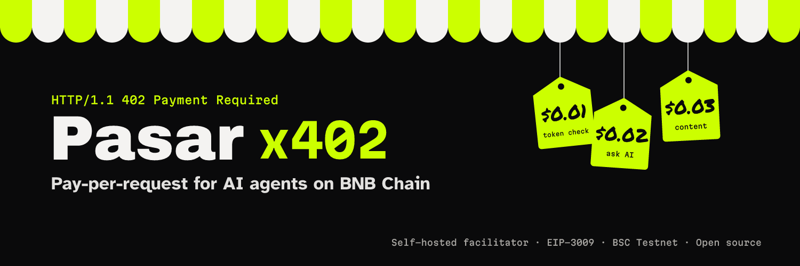

<p align="center"></p>

# Pasar x402

An open-source market where AI agents pay **per request** on BNB Chain, built on the [x402](https://docs.x402.org) protocol (HTTP `402 Payment Required`). It ships six working stalls, a self-hosted facilitator and a gasless test stablecoin, **Pasar USD (pUSD)**. Everything runs for $0.

```
Agent ──GET /api/token-check/0x…─────▶ Stall
      ◀── 402 + PAYMENT-REQUIRED ──── (price, token, network, recipient)
      ── EIP-3009 signature ────────▶ Stall ──/verify──▶ Facilitator
      ◀── data + PAYMENT-RESPONSE ─── Stall ──/settle──▶ Facilitator ──tx──▶ BNB Smart Chain
```

The buyer only signs (no gas, no approval). The facilitator sends the transaction and pays the gas. Settlement happens **only after the stall has served successfully**: if a stall fails, the buyer is not charged.

## The six stalls

| Stall | What it sells | Endpoint | Price |
|---|---|---|---|
| **Token Check** | Buy-and-sell simulation (honeypots), buy and sell tax, owner powers (mint, blacklist, fee changes), proxies, PancakeSwap liquidity, burned or owner-held LP. Read live from BSC mainnet, no third-party APIs. | `GET /api/token-check/{address}` | $0.01 |
| **Paid MCP** | A Streamable-HTTP MCP server that charges per tool call through `_meta["x402/payment"]`. Tools: `market_info` (free), `token_check`, `ask_ai`. | `POST /mcp` | $0.01–0.02 per call |
| **Shopping Agent** | An agent wallet with a daily budget, a per-payment cap, a host allowlist and a receipt log. Ships as a CLI, a Telegram bot and an MCP bridge for Claude. | `npm run agent` · `bot` · `mcp:bridge` | your budget |
| **x402 Gateway** | A reverse proxy that puts an x402 paywall in front of any API, configured in `gateway.config.json`. | port 4022 | per route |
| **Laptop AI** | Sells answers from a local Ollama model. While the model is offline, requests are refused and nobody is charged. | `POST /api/ai/generate` | $0.02 |
| **Pay-per-Item Content** | Articles and files sold one at a time (`content/`). The 402 answer includes a preview. | `GET /api/content/{id}` | per item |

There is also a website (`web/`) and a brand kit (`brand/`).

## Quick start: local chain (no faucet)

Requires Node.js 22 or newer.

```bash
npm install
npm run build      # compile contracts and export ABIs
npm run dev        # Hardhat chain + pUSD deploy + facilitator + stalls + gateway
```

In a second terminal:

```bash
npm run demo                                                   # the agent buys from every stall
npm run agent -- 0x0E09FaBB73Bd3Ade0a17ECC321fD13a19e81cE82    # check the CAKE token
npm run agent                                                  # interactive mode
```

Open the website at http://127.0.0.1:4021.

### Agent commands

| Command | What it does |
|---|---|
| `0xTokenAddress` | paid BSC token risk check |
| `mcp 0xTokenAddress` | the same check through the paid MCP server |
| `ask <question>` | ask the local AI |
| `catalog` | list stalls and content |
| `read <id>` | buy one content item |
| `gateway [/path]` | buy data through the x402 Gateway (default `/bsc/gas`) |
| `balance`, `budget`, `history` | wallet, spending limits, receipts |

## BNB Smart Chain testnet

```bash
npm run setup      # writes .env with three new wallets (facilitator, seller, agent)
```

1. Send test BNB to the printed **facilitator** address from https://www.bnbchain.org/en/testnet-faucet. The agent needs no BNB.
2. Deploy the token and fund the agent:
   ```bash
   npm run deploy   # deploys pUSD and mints 1,000 pUSD to the agent
   npm run dev
   ```
3. Shop: `npm run agent -- 0x…tokenAddress`. Every receipt links to testnet.bscscan.com.

## Shop from Claude (MCP bridge)

The bridge lets Claude Code, Claude Desktop or Cursor buy from the stalls with the agent wallet, within the limits in `.env`. Keep `npm run dev` running.

```bash
claude mcp add pasar-x402 -- npx tsx /absolute/path/to/pasar-x402/src/agent/mcp-bridge.ts
```

For Claude Desktop, add this to `claude_desktop_config.json`:

```json
{
  "mcpServers": {
    "pasar-x402": {
      "command": "npx",
      "args": ["tsx", "/absolute/path/to/pasar-x402/src/agent/mcp-bridge.ts"]
    }
  }
}
```

Tools: `market_catalog`, `market_token_check`, `market_ask_ai`, `market_read_content`, `market_wallet`.

## Telegram bot

1. Create a bot with @BotFather and set `TELEGRAM_BOT_TOKEN` in `.env`.
2. Set `TELEGRAM_ALLOWED_USERS` to your Telegram user id. Anyone who can message the bot spends the agent's budget.
3. Run `npm run bot`, then send a token address, `ask …`, `catalog`, `read <id>`, `balance` or `budget`.

## Laptop AI (Ollama)

Install Ollama from https://ollama.com, then:

```bash
ollama pull qwen2.5:1.5b
```

Choose another model with `OLLAMA_MODEL`. Check that the model's license allows commercial use before you sell its answers.

## x402 Gateway

Edit `gateway.config.json`:

```json
{
  "routes": [
    { "method": "GET", "path": "/bsc/*", "upstream": "http://127.0.0.1:4021/api/public", "price": "$0.01" }
  ]
}
```

After payment, `GET http://127.0.0.1:4022/bsc/gas` is forwarded to `…/api/public/gas`. Point `upstream` at your own API.

## Brand kit

`npm run brand` regenerates everything in `brand/`:

| File | Size | Use |
|---|---|---|
| `logo-mark.svg`, `logo-mark-512.png` | 64 / 512 px | icon, avatar |
| `logo-light.svg/png`, `logo-dark.svg/png` | horizontal lockup | light and dark backgrounds |
| `banner.png` | 1500×500 | X/Twitter header |
| `og.png` | 1200×630 | link previews |
| `favicon-32.png`, `apple-touch-icon.png` | 32 / 180 px | favicons |

Text in the SVGs is converted to paths, so the files render identically without the fonts installed.

## Project layout

```
contracts/        PasarUSD.sol (ERC-20 + EIP-3009 + EIP-2612), TokenProbe.sol (buy/sell simulation)
test/             contract tests + an end-to-end x402 settlement
src/facilitator/  self-hosted x402 facilitator (/supported, /verify, /settle)
src/stalls/       token check, AI, content, MCP, website server
src/gateway/      x402 Gateway (reverse proxy)
src/agent/        agent wallet, CLI, Telegram bot, MCP bridge
scripts/          setup, deploy, dev, demo, build-brand
content/          paid content (Markdown + front matter)
web/              website
brand/            logo, banner, Open Graph image
```

## Scripts

| Script | Purpose |
|---|---|
| `npm run build` | compile contracts and export ABIs to `src/generated` |
| `npm test` | contract tests + x402 settlement |
| `npm run typecheck` | TypeScript type check |
| `npm run setup` | create a testnet `.env` with new wallets (never overwrites an existing one) |
| `npm run deploy` | deploy pUSD to the network in `.env` |
| `npm run dev` | start every service (plus a local chain when `NETWORK=local`) |
| `npm run demo` | the agent buys from every stall |
| `npm run facilitator` / `server` / `gateway` | start one service |
| `npm run agent` / `bot` / `mcp:bridge` | agent front ends |
| `npm run brand` | regenerate the brand kit |

## Security and limits

- **Testnet first.** pUSD is a test token with no value. In local mode the private keys are Hardhat's public dev keys.
- **Guard `.env`.** It holds private keys and is listed in `.gitignore`.
- **The facilitator** only settles pUSD, on the configured network, to `PAY_TO_ADDRESS`, and is protected by `FACILITATOR_API_KEY`. Never expose port 4020 without the key.
- **Mainnet:** USDT and USDC on BSC do not implement EIP-3009. Use x402's Permit2 flow (the buyer approves once) or another BSC facilitator, and charge at least about $0.01 so settlement gas is covered.
- **Token Check** is an on-chain heuristic, not financial advice. Owner powers are detected from common function selectors in the bytecode, and liquidity is only read from PancakeSwap v2 (WBNB and USDT pairs).
- **Regulation:** crypto payments are restricted in some countries; in Indonesia crypto is not a legal means of payment. Check the rules where you operate before taking real money.

## License

MIT. Independent project; not affiliated with BNB Chain, Coinbase or the x402 Foundation.
